# Short Video Maker

[](https://github.com/ANI-IN/short-video-maker/actions/workflows/selftest.yml)


Make finished vertical videos (9:16, 1080×1920) for Instagram Reels and YouTube Shorts on your own computer, driven
from **Claude Code**: script → **ElevenLabs** narration → one of **27 animated styles** (or licensed footage) →
word-by-word captions → music and sound effects → quality-checked MP4.

```text
/video-from-script my-script.txt --style edtech
```

That one line in Claude Code turns your script into a finished, captioned, narrated video in `output/`.
There is no web app and no server: everything runs from Claude Code or the terminal.

---

## Contents

1. [Sample videos](#1-sample-videos)
2. [Quick start](#2-quick-start)
3. [Prerequisites and dependencies](#3-prerequisites-and-dependencies)
4. [Installation (macOS, Windows, Linux)](#4-installation)
5. [Claude Code: install, configure, use](#5-claude-code)
6. [ElevenLabs: paid plan, API key, voices](#6-elevenlabs)
7. [Making videos: exact commands](#7-making-videos)
8. [Video styles and their commands](#8-video-styles)
9. [Where videos, audio and other outputs are stored](#9-where-outputs-are-stored)
10. [Adding new styles and voices](#10-adding-new-styles-and-voices)
11. [Repository structure](#11-repository-structure)
12. [Configuration reference](#12-configuration-reference)
13. [Platform support and verification](#13-platform-support-and-verification)
14. [Troubleshooting and common errors](#14-troubleshooting-and-common-errors)
15. [FAQ](#15-faq)
16. [Security and privacy](#16-security-and-privacy)
17. [Third-party software and licence](#17-third-party-software-and-licence)

---

## 1. Sample videos

All narrated by the default ElevenLabs voice (**Liam**), used exactly as ElevenLabs delivers it.

| Video | Style | Length | How it was made |
|---|---|---|---|
| [MCP explained](samples/mcp-explainer-reel.mp4) | EDTech canvas | 96 s | Hand-tuned composition, sources in [`examples/reels/mcp/`](examples/reels/mcp/) |
| [RAG explained](samples/rag-explainer-reel.mp4) | EDTech canvas | 83 s | Hand-tuned composition, sources in [`examples/reels/rag/`](examples/reels/rag/) |
| [How a UPI payment works](samples/upi-explainer-reel.mp4) | EDTech canvas | 87 s | Hand-tuned composition, sources in [`examples/reels/upi/`](examples/reels/upi/) |
| [How this project works](samples/project-overview.mp4) | EDTech | 68 s | `python3 video.py make examples/storyboards/project-overview.json --style edtech` |
| [27 style previews](samples/styles/) | every style | 20–30 s each | `python3 video.py samples` (see [§8](#8-video-styles)) |

The three explainers are hand-built Remotion compositions where every animation is keyed to a spoken word; the
reusable **EDTech** style was distilled from them. Everything else is produced end to end by the pipeline.

## 2. Quick start

```bash
# 1. Clone
git clone https://github.com/ANI-IN/short-video-maker.git
cd short-video-maker

# 2. Install (checks your tools, creates the Python environments, downloads the render engines)
./setup.sh                      # Windows: setup.cmd

# 3. Add your ElevenLabs API key (paid plan): edit .env, or type it hidden:
python3 video.py voices key     # Windows: py video.py voices key

# 4. Check everything
python3 video.py doctor         # Windows: py video.py doctor

# 5. Make a video: in Claude Code ...
claude
#    /video-from-script examples/scripts/what-is-an-api.txt --style edtech
#    ... or straight from the terminal:
python3 video.py script examples/scripts/what-is-an-api.txt --title "What is an API" --style edtech --mode fast
```

The video appears in `output/what-is-an-api-<date>/final/what-is-an-api-<date>.mp4`.

> **Windows:** wherever this README writes `python3 video.py`, type `py video.py`. Everything else is the same.

## 3. Prerequisites and dependencies

### Tools you install

| Tool | Version | Why | macOS | Windows | Linux (Debian/Ubuntu) |
|---|---|---|---|---|---|
| **Python** | 3.12 (3.11+ works, 3.12 tested) | Pipeline and checks | `brew install python@3.12` | `winget install Python.Python.3.12` | `sudo apt install python3.12 python3.12-venv` |
| **Node.js** | 20 or newer (22 tested) | Remotion and explainroo render engines | `brew install node` | `winget install OpenJS.NodeJS.LTS` | [nodejs.org](https://nodejs.org) or `nvm install 22` |
| **ffmpeg** (with ffprobe) | 6 or newer (9.0 tested) | Encoding, loudness, mixing | `brew install ffmpeg` | `winget install Gyan.FFmpeg` | `sudo apt install ffmpeg` |
| **git** | any | Cloning; setup downloads the explainroo engine | `xcode-select --install` | `winget install Git.Git` | `sudo apt install git` |
| **Claude Code** | latest | Runs the project's slash commands; writes scripts from topics | [§5](#5-claude-code) | [§5](#5-claude-code) | [§5](#5-claude-code) |
| **ElevenLabs account** | paid plan (Starter or higher) | All narration | [§6](#6-elevenlabs) | | |

On macOS, install [Homebrew](https://brew.sh) first. On Windows, `winget` ships with Windows 10/11; after installing a
tool, **open a new terminal** so it is on `PATH`. On Linux distributions other than Debian/Ubuntu use your package
manager's equivalents (`dnf`, `pacman`, ...).

### What the setup installs for you

| Where | What | Size |
|---|---|---|
| `.venv/` (Python) | PyTorch + transformers (CLIP footage ranking, depth), librosa, NumPy/SciPy, Pillow, OCR (`ocrmac` on macOS, `rapidocr-onnxruntime` elsewhere): [`requirements.txt`](requirements.txt) | about 2–4 GB |
| `.venv-tts/` (Python) | Whisper speech recognition: `mlx-whisper` on Apple Silicon, `faster-whisper` elsewhere: [`requirements-voice.txt`](requirements-voice.txt) | about 0.5 GB |
| `explainroo/` | [explainroo](https://github.com/vincentsch/explainroo) 0.6.2 render engine (MIT), cloned at a pinned commit, plus its Node packages | about 0.5 GB |
| `styles/remotion/node_modules/` | [Remotion](https://www.remotion.dev) 4 and a headless Chromium | about 0.6 GB |
| `~/.cache/huggingface/` (first video) | Whisper large-v3-turbo (about 1.6 GB); CLIP (about 0.6 GB, footage styles only) | about 2 GB |

### Hardware

8 GB RAM works (this project was built on a MacBook Air M2 with 8 GB); 16 GB is more comfortable. About 10 GB of
free disk. No graphics card needed. An Apple Silicon Mac or an NVIDIA GPU makes the Whisper checks faster.

## 4. Installation

The setup is one script, [`install.py`](install.py) (Python standard library only), wrapped by `setup.sh` and
`setup.cmd`. It is safe to re-run at any time (for example after `git pull`).

### macOS

```bash
brew install python@3.12 node ffmpeg git
git clone https://github.com/ANI-IN/short-video-maker.git
cd short-video-maker
./setup.sh
```

### Windows 10/11 (PowerShell or Command Prompt)

```bat
winget install Python.Python.3.12
winget install OpenJS.NodeJS.LTS
winget install Gyan.FFmpeg
winget install Git.Git
```

Close the terminal, open a new one, then:

```bat
git clone https://github.com/ANI-IN/short-video-maker.git
cd short-video-maker
setup.cmd
```

When installing Python from python.org instead, tick **Add python.exe to PATH**. Keep the project in a short path
(for example `C:\code\short-video-maker`) to stay clear of Windows' 260-character path limit inside `node_modules`.

### Linux (Ubuntu/Debian)

```bash
sudo apt update
sudo apt install -y python3.12 python3.12-venv ffmpeg git curl
curl -fsSL https://deb.nodesource.com/setup_22.x | sudo -E bash - && sudo apt install -y nodejs
git clone https://github.com/ANI-IN/short-video-maker.git
cd short-video-maker
./setup.sh
```

If your distribution has no `python3.12` package, use [pyenv](https://github.com/pyenv/pyenv) or the deadsnakes PPA.
Remotion's headless Chromium needs the usual browser libraries; on a minimal server install them with
`sudo apt install -y libnss3 libatk1.0-0 libatk-bridge2.0-0 libcups2 libdrm2 libxkbcommon0 libxcomposite1 libxdamage1 libxrandr2 libgbm1 libpango-1.0-0 libasound2`.
On a machine without an NVIDIA GPU, PyTorch's CPU wheels are much smaller: before running the setup,
`export PIP_EXTRA_INDEX_URL=https://download.pytorch.org/whl/cpu`.

### What the setup does

1. Checks Python, Node 20+, ffmpeg/ffprobe and git, and prints the install command for anything missing.
2. Creates `.venv` and installs `requirements.txt`.
3. Creates `.venv-tts` and installs `requirements-voice.txt` (the right Whisper backend for your system).
4. Clones explainroo at the tested commit and runs `npm ci` in it.
5. Runs `npm ci` in `styles/remotion`.
6. Creates `output/` and copies `.env.example` to `.env`.

### Check the installation

```bash
python3 video.py doctor      # every required row must say OK
python3 video.py selftest    # offline end-to-end check (no API key, no credits): Whisper, OCR, Remotion, explainroo, ffmpeg
```

## 5. Claude Code

[Claude Code](https://docs.claude.com/en/docs/claude-code/overview) is Anthropic's agent for the terminal. In this
project it is the main interface: the repository ships slash commands (`.claude/commands/`) and a project guide
([`CLAUDE.md`](CLAUDE.md)) so Claude Code knows how to set up, make and check videos.

### Install

| System | Command |
|---|---|
| macOS, Linux, WSL | `curl -fsSL https://claude.ai/install.sh \| bash` |
| Windows (PowerShell) | `irm https://claude.ai/install.ps1 \| iex` |
| Any system with Node 18+ | `npm install -g @anthropic-ai/claude-code` |

Windows also needs **Git for Windows** (`winget install Git.Git`): Claude Code uses its Git Bash to run commands.
Check the install with `claude --version`.

### Log in (once)

```bash
claude
```

The first start opens your browser to sign in with a Claude subscription (Pro or Max) or an Anthropic Console
account with API credits. Run `/login` inside Claude Code to switch accounts later.

### Use it in this project

```bash
cd short-video-maker
claude
```

Then type one of the project's commands:

| Command | What it does |
|---|---|
| `/setup` | Runs the setup for your OS, then `video.py doctor`, and walks you through the ElevenLabs key |
| `/video-from-script <file or pasted text> [--style S] [--lang en\|hi\|hl] [--mode fast\|max\|cinematic] [--voice KEY]` | Your own script, used word for word |
| `/make-video <topic> [60s] [--style S] [--mode M]` | Researches the topic (web search), writes and checks a script for Instagram Reels, then makes the video |
| `/styles [topic]` | Lists the styles with previews and commands, or recommends styles for a topic |
| `/voices [list \| use KEY \| add ID \| test "line" \| account]` | Lists, tests, adds or changes ElevenLabs voices |

Examples:

```text
/setup
/video-from-script examples/scripts/what-is-an-api.txt --style edtech --mode fast
/make-video How does UPI work 60s --style edtech
/make-video The story of the Konark Sun Temple 90s --style documentary-history
/styles a video about compound interest
/voices test "Hello from my first video" --voice sarah
```

You can also ask in plain words ("make a 45-second Hindi video from this script in the whiteboard style");
`CLAUDE.md` tells Claude Code which commands to run. Claude Code asks before running commands unless you allow them;
allowing `python3 video.py:*` (Windows `py video.py:*`) for this project saves the prompts.

**Never paste your ElevenLabs key into the Claude Code chat.** Put it in `.env` or run `python3 video.py voices key` in
your own terminal ([§6](#6-elevenlabs)).

> **Do I need Claude Code?** For `/make-video` (topic research and script writing), yes. Your own scripts also work
> without it, straight from the terminal: `python3 video.py script ...` ([§7](#7-making-videos)).

## 6. ElevenLabs

All narration comes from [ElevenLabs](https://elevenlabs.io) through its API, with **your own account**. The voice is
used **exactly as ElevenLabs delivers it**: no voice settings are sent (each voice keeps its own default speed,
stability and style) and the audio is never sped up, slowed down, re-paced or re-equalised. Each scene is one request,
with the neighbouring scenes sent as context so the read flows across cuts. Whisper then listens to every take; if it
mishears the script, that scene is requested again with a new seed.

### Plan

Use a **paid plan (Starter or higher)**. Paid plans include a commercial licence for the audio and API access to the
voice library. Every plan has a monthly character budget ("credits"): one credit per character spoken with
`eleven_multilingual_v2`. Check current plans and prices on [elevenlabs.io/pricing](https://elevenlabs.io/pricing).
For scale: this project was built on a Starter plan with 40,000 credits a month.

| Video | Script length | Credits |
|---|---|---|
| 30 s | about 450 characters | about 450 |
| 60 s | about 900 characters | about 900 |
| 90 s | about 1,350 characters | about 1,350 |

Re-rendering the same script costs nothing: takes are cached in `output/.cache/elevenlabs/`. A scene is paid for again
only when Whisper mishears it (max/cinematic modes) or when you change its words.

### Create the API key

1. Sign in at [elevenlabs.io](https://elevenlabs.io) and choose a paid plan under **Subscription**.
2. Open **Developers → API keys → Create API key** ([direct link](https://elevenlabs.io/app/settings/api-keys)).
3. Give it these permissions: **Text to Speech** (required), **Voices: Read** (required), **User: Read** (optional;
   shows your credit balance in `video.py voices account` and `doctor`). Optionally set a monthly credit limit on the key.
4. Copy the key. ElevenLabs shows it only once.

### Give the key to the project

Either open `.env` in the project folder (the setup created it from [`.env.example`](.env.example)) and set:

```bash
ELEVENLABS_API_KEY=sk_your_key_here
```

or run this in **your own terminal** (input is hidden; the key is checked with ElevenLabs before it is saved):

```bash
python3 video.py voices key
```

`.env` is git-ignored and never leaves your computer except in requests to ElevenLabs. Verify:

```bash
python3 video.py voices account
# Key OK · plan: starter · 12,078 of 40,000 credits used · 27,922 left · resets 20/12/2026
```

### Voices

The registry [`config/voices.json`](config/voices.json) lists the 21 official ElevenLabs default voices (usable by
every account). The default narrator is **Liam** (`TX3LPaxmHKxFdv7VOQHJ`): young American male, energetic and warm,
made for Reels and Shorts.

```bash
python3 video.py voices list                      # all voices; * marks the default
python3 video.py voices list --filter female      # filter by name, gender, accent, use
python3 video.py voices test "Is this the voice for my channel?" --voice sarah   # saves output/voice-tests/*.mp3
python3 video.py voices use sarah                 # make Sarah the default for every new video
python3 video.py voices use sarah --lang hi       # use Sarah only for Hindi videos
python3 video.py script my.txt --title "T" --voice george    # one video with George
```

In Claude Code: `/voices`, `/voices test "Hello" --voice sarah`, `/voices use sarah`.
Full voice table, per-language voices and voices inside storyboards: [docs/voices.md](docs/voices.md).

## 7. Making videos

### A. In Claude Code (recommended)

```text
/video-from-script examples/scripts/what-is-an-api.txt --style edtech
/video-from-script my-script.txt --style whiteboard --lang en --mode max --voice sarah
/make-video What is RAG in AI 60s --style edtech
/make-video Why did the Mughal empire decline 90s --style documentary-history --mode max
```

You can also paste a script straight into the chat after `/video-from-script`.

### B. From the terminal

Your own script (plain text file):

```bash
python3 video.py script examples/scripts/what-is-an-api.txt --title "What is an API" --style edtech
```

A storyboard JSON (full control over every scene; format in [docs/storyboard.md](docs/storyboard.md)):

```bash
python3 video.py make examples/storyboards/edtech.json --style edtech --mode fast --allow-lint-fail --name api-test
```

Other commands:

```bash
python3 video.py -h            # every command
python3 video.py styles        # every style with its command
python3 video.py list          # videos made on this computer
python3 video.py feedback what-is-an-api-1125-2010 --views 12000 --likes 900 --rating good   # teach it what worked
```

### Options

| Option | Values | Default | Meaning |
|---|---|---|---|
| `--style` | any name from `video.py styles` | `edtech` | Visual style ([§8](#8-video-styles)) |
| `--lang` | `en`, `hi`, `hl` | `en` | English, Hindi, Hinglish (Roman captions, Devanagari voice text) |
| `--mode` | `fast`, `max`, `cinematic` | `max` | `fast`: one take, quick encode, checks without auto-fix (≈3–5 min per 60 s). `max`: up to 3 takes per scene, full checks with 2 auto-fix rounds (≈10–15 min). `cinematic`: up to 5 takes, 4 fix rounds, slowest encode |
| `--title` | text | required for `script` | Title; also names the output folder |
| `--name` | text | title + date-time | Output folder and file name |
| `--out` | folder | `output/<name>` | Where to write |
| `--voice` | a key from `video.py voices list` | the default voice | Narrator for this video (`script` only; storyboards use `"hosts"`) |
| `--allow-lint-fail` | flag | off | `make` only: don't stop on the hook/wording rules meant for AI-written scripts |

### Script format

```text
# What is an *API*?
What does an API actually do? Most developers use one every day.

Two apps can't read each other's code. They need a contract.

# The *menu*
An API is the menu one app offers another:
- what you can ask for
- what you get back

Which API do you use most? Tell me in the comments.
```

- A **blank line** starts a new scene. Aim for 6–14 seconds per scene (about 15–35 words).
- The **first scene is the hook**, the **last is the call to action**.
- An optional first line `# Headline` sets the on-screen headline; `*word*` highlights a word.
- Lines starting with `- ` become numbered cards in styles that show lists.
- Length: about 2.5 words per second, so 150 words ≈ 60 s.
- Save as UTF-8 text (any editor does this; Hindi in Devanagari works).

### What happens when you make a video

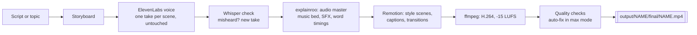

The 13 quality checks: caption timing, pace (reported only), word pace, clicks at joins, music level under the voice,
cut placement, pronunciation (Whisper re-hears the final mix), footage relevance, motion, frame balance, text layout,
caption band and stray text. A video that fails a check is reported as failed, with the reason, in its report.
More diagrams: [docs/diagrams/](docs/diagrams/).

## 8. Video styles

27 styles on two render engines. **Gallery with a preview picture and every command for each style:
[docs/styles.md](docs/styles.md).** Preview videos are in [`samples/styles/`](samples/styles/).

The command per style (Windows: `py` instead of `python3`; in Claude Code: `/video-from-script my-script.txt --style STYLE`):

| Preview | Style | Best for | Command |
|---|---|---|---|
| [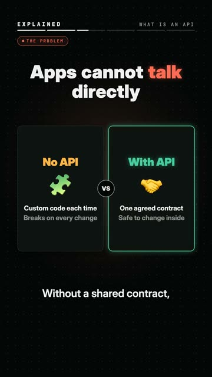](samples/styles/edtech.mp4) | **[`edtech`](docs/styles.md#edtech)**<br>Explainer | Tech and concept explainers, interview-style questions, step-by-step teaching | `python3 video.py script my-script.txt --title "My video" --style edtech` |
| [](samples/styles/documentary-history.mp4) | **[`documentary-history`](docs/styles.md#documentary-history)**<br>Documentary | History and biography: mixes archive footage, maps, timelines and reenactments | `python3 video.py script my-script.txt --title "My video" --style documentary-history` |
| [](samples/styles/real-footage.mp4) | **[`real-footage`](docs/styles.md#real-footage)**<br>Real footage | News, places, people and modern events that real photos or clips can show | `python3 video.py script my-script.txt --title "My video" --style real-footage` |
| [](samples/styles/character-story.mp4) | **[`character-story`](docs/styles.md#character-story)**<br>Story & characters | Stories and mythology where named characters act out a scene | `python3 video.py script my-script.txt --title "My video" --style character-story` |
| [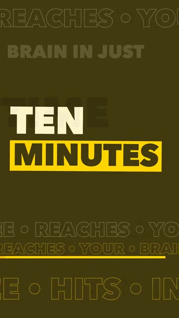](samples/styles/kinetic-typography.mp4) | **[`kinetic-typography`](docs/styles.md#kinetic-typography)**<br>Text/typography | Punchy opinion or fact videos where the words are the picture | `python3 video.py script my-script.txt --title "My video" --style kinetic-typography` |
| [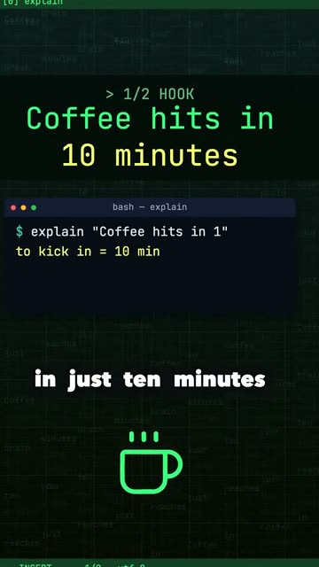](samples/styles/typewriter-terminal.mp4) | **[`typewriter-terminal`](docs/styles.md#typewriter-terminal)**<br>Text/typography | Developer and command-line topics | `python3 video.py script my-script.txt --title "My video" --style typewriter-terminal` |
| [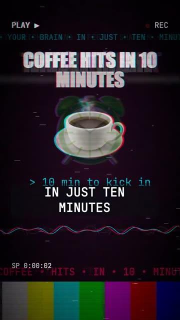](samples/styles/glitch-vhs.mp4) | **[`glitch-vhs`](docs/styles.md#glitch-vhs)**<br>Text/typography | Gaming, internet culture, edgy tech takes | `python3 video.py script my-script.txt --title "My video" --style glitch-vhs` |
| [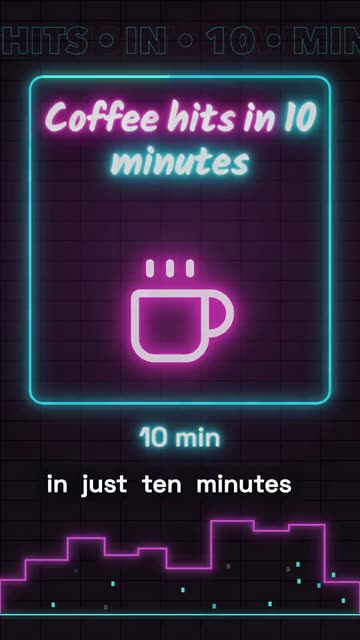](samples/styles/neon-glow.mp4) | **[`neon-glow`](docs/styles.md#neon-glow)**<br>Text/typography | Night-life, music and bold announcements | `python3 video.py script my-script.txt --title "My video" --style neon-glow` |
| [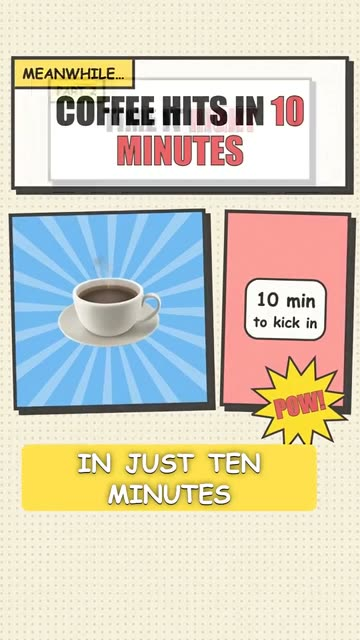](samples/styles/comic-book.mp4) | **[`comic-book`](docs/styles.md#comic-book)**<br>Text/typography | Fun facts, listicles, pop-culture trivia | `python3 video.py script my-script.txt --title "My video" --style comic-book` |
| [](samples/styles/whiteboard.mp4) | **[`whiteboard`](docs/styles.md#whiteboard)**<br>Illustration/hand-drawn | Classroom-style explanations and how-tos | `python3 video.py script my-script.txt --title "My video" --style whiteboard` |
| [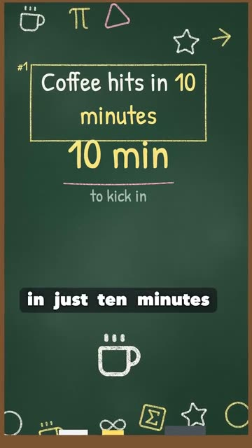](samples/styles/chalkboard.mp4) | **[`chalkboard`](docs/styles.md#chalkboard)**<br>Illustration/hand-drawn | School subjects, maths and science basics | `python3 video.py script my-script.txt --title "My video" --style chalkboard` |
| [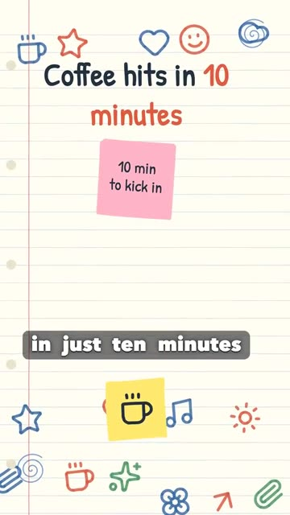](samples/styles/notebook-doodle.mp4) | **[`notebook-doodle`](docs/styles.md#notebook-doodle)**<br>Illustration/hand-drawn | Study tips, personal notes, light tutorials | `python3 video.py script my-script.txt --title "My video" --style notebook-doodle` |
| [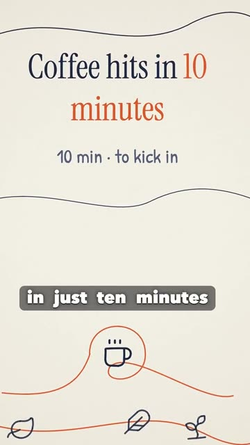](samples/styles/line-art.mp4) | **[`line-art`](docs/styles.md#line-art)**<br>Illustration/hand-drawn | Calm, minimal concept explainers | `python3 video.py script my-script.txt --title "My video" --style line-art` |
| [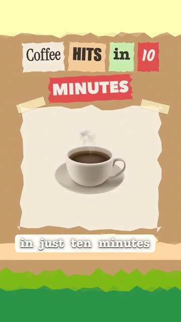](samples/styles/paper-cutout.mp4) | **[`paper-cutout`](docs/styles.md#paper-cutout)**<br>Illustration/hand-drawn | Craft, lifestyle and playful storytelling | `python3 video.py script my-script.txt --title "My video" --style paper-cutout` |
| [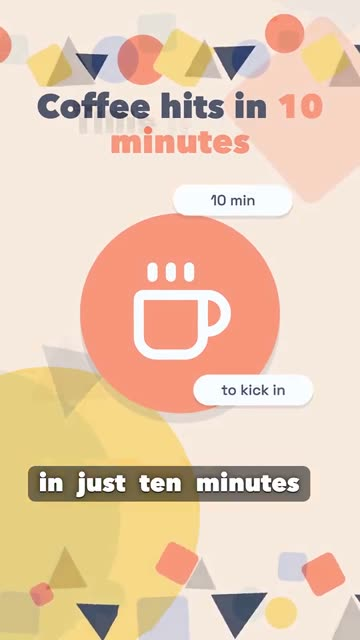](samples/styles/flat-icons.mp4) | **[`flat-icons`](docs/styles.md#flat-icons)**<br>Flat & motion graphics | Product tips, app features, clean corporate explainers | `python3 video.py script my-script.txt --title "My video" --style flat-icons` |
| [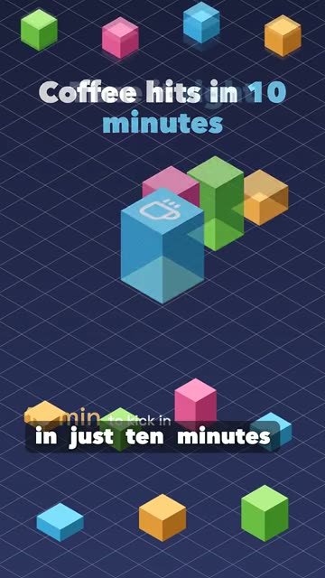](samples/styles/isometric.mp4) | **[`isometric`](docs/styles.md#isometric)**<br>Flat & motion graphics | Systems, comparisons and data with a 3D feel | `python3 video.py script my-script.txt --title "My video" --style isometric` |
| [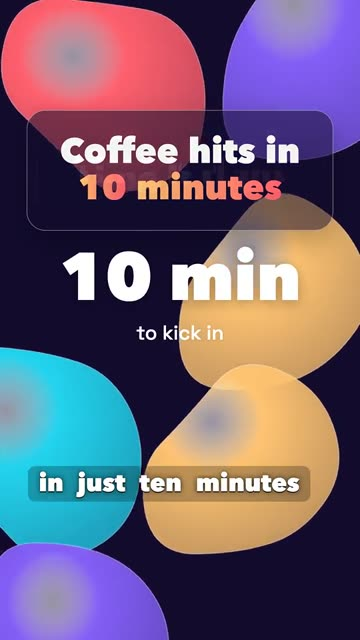](samples/styles/gradient-blob.mp4) | **[`gradient-blob`](docs/styles.md#gradient-blob)**<br>Flat & motion graphics | Single big statistic or modern brand-style statement | `python3 video.py script my-script.txt --title "My video" --style gradient-blob` |
| [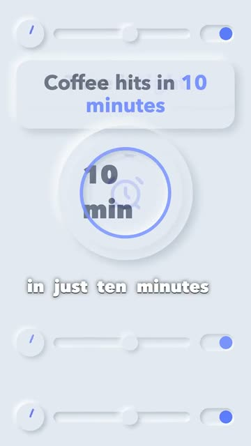](samples/styles/neumorphism.mp4) | **[`neumorphism`](docs/styles.md#neumorphism)**<br>Flat & motion graphics | Checklists and soft, app-like product explainers | `python3 video.py script my-script.txt --title "My video" --style neumorphism` |
| [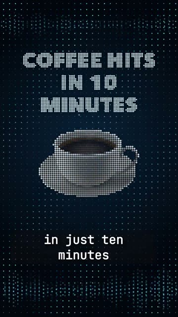](samples/styles/particle-dots.mp4) | **[`particle-dots`](docs/styles.md#particle-dots)**<br>Flat & motion graphics | Dramatic reveals and one-line statements | `python3 video.py script my-script.txt --title "My video" --style particle-dots` |
| [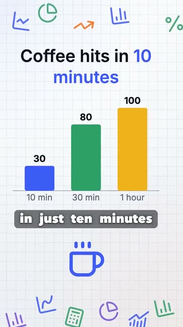](samples/styles/bar-pie-chart.mp4) | **[`bar-pie-chart`](docs/styles.md#bar-pie-chart)**<br>Data & infographic | Comparing numbers: rankings, shares, before and after | `python3 video.py script my-script.txt --title "My video" --style bar-pie-chart` |
| [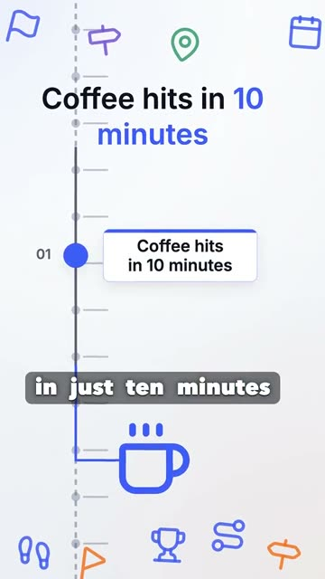](samples/styles/timeline-roadmap.mp4) | **[`timeline-roadmap`](docs/styles.md#timeline-roadmap)**<br>Data & infographic | Histories, roadmaps and step sequences with dates | `python3 video.py script my-script.txt --title "My video" --style timeline-roadmap` |
| [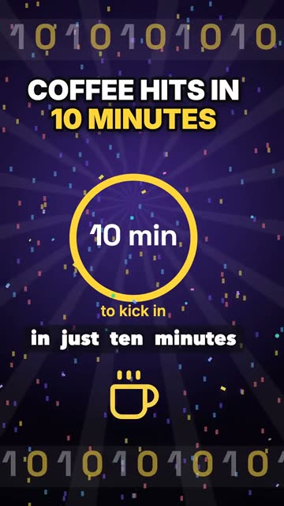](samples/styles/number-ticker.mp4) | **[`number-ticker`](docs/styles.md#number-ticker)**<br>Data & infographic | One headline number that should land hard | `python3 video.py script my-script.txt --title "My video" --style number-ticker` |
| [](samples/styles/map-geo-pins.mp4) | **[`map-geo-pins`](docs/styles.md#map-geo-pins)**<br>Data & infographic | Stories tied to places: travel, geography, logistics | `python3 video.py script my-script.txt --title "My video" --style map-geo-pins` |
| [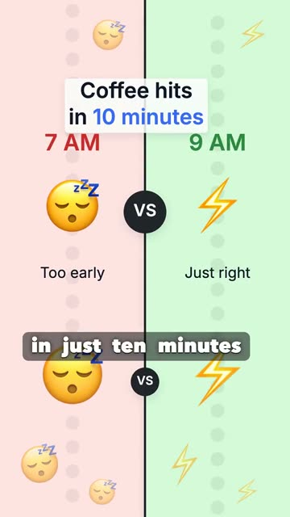](samples/styles/split-screen.mp4) | **[`split-screen`](docs/styles.md#split-screen)**<br>Data & infographic | Two-sided comparisons: A versus B | `python3 video.py script my-script.txt --title "My video" --style split-screen` |
| [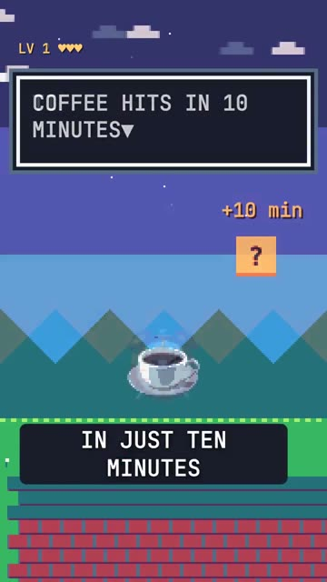](samples/styles/pixel-art.mp4) | **[`pixel-art`](docs/styles.md#pixel-art)**<br>Retro & novelty | Retro gaming and nostalgic topics | `python3 video.py script my-script.txt --title "My video" --style pixel-art` |
| [](samples/styles/emoji-pop.mp4) | **[`emoji-pop`](docs/styles.md#emoji-pop)**<br>Retro & novelty | Light, upbeat social content | `python3 video.py script my-script.txt --title "My video" --style emoji-pop` |
| [](samples/styles/old-film.mp4) | **[`old-film`](docs/styles.md#old-film)**<br>Retro & novelty | Vintage stories and 'back in the day' facts | `python3 video.py script my-script.txt --title "My video" --style old-film` |

The example storyboards behind the previews are in [`examples/storyboards/`](examples/storyboards/); to render one
yourself: `python3 video.py make examples/storyboards/sample.json --style whiteboard --mode fast --allow-lint-fail`.

## 9. Where outputs are stored

Everything you make goes into `output/` (git-ignored), one folder per video:

```text
output/
├── what-is-an-api-1125-2010/          one video (name = title + date-time, or --name)
│   ├── storyboard.json                the scenes, made from your script or by /make-video
│   ├── research.md, hooks.json        /make-video only: research notes, sources, hook candidates
│   ├── final/
│   │   ├── what-is-an-api-1125-2010.mp4              ← THE VIDEO (1080×1920, 30 fps, H.264 + AAC)
│   │   ├── what-is-an-api-1125-2010.cover.jpg        cover frame for Instagram/YouTube
│   │   ├── what-is-an-api-1125-2010.caption.txt      post caption + hashtags
│   │   ├── what-is-an-api-1125-2010.report.json      every QC check, timings, voice, fixes applied
│   │   ├── what-is-an-api-1125-2010.sheet.jpg        contact sheet of frames for a quick visual review
│   │   └── what-is-an-api-1125-2010.CREDITS.txt      licences of any footage used (footage styles)
│   ├── voice/en/
│   │   ├── <scene>.wav                ElevenLabs narration per scene, exactly as delivered (edge silence trimmed)
│   │   ├── takes/                     every take received, including ones Whisper rejected
│   │   └── voice_qc.json              what Whisper heard per take, which take was used
│   ├── footage/                       downloaded licensed photos/clips (footage styles)
│   └── work/
│       ├── mix-en.wav                 final audio: voice + ducked music + sound effects
│       ├── mix-voice.wav              voice stem
│       ├── music-ducked.wav           music bed after ducking
│       ├── composite-en.mp4           picture before the final encode
│       └── pipeline-en.log            full log of the run
├── voice-tests/                       clips from `video.py voices test`
├── scripts/                           scripts you pasted into /video-from-script
└── .cache/                            ElevenLabs takes and footage cache (safe to delete; keeping it saves credits)
```

`python3 video.py list` prints every finished video with its path. Delete a video's folder to remove it.

## 10. Adding new styles and voices

### A new voice

- **From your ElevenLabs account** (a voice you designed, or a Voice Library voice you added to *My Voices*): copy its
  ID (Voices → ⋯ → *Copy voice ID*), then
  ```bash
  python3 video.py voices add AbCdEfGhIjKlMnOpQrSt --name "My narrator"
  python3 video.py voices use my-narrator
  ```
- **By hand:** add an entry to `config/voices.json` (`name`, `voice_id`, `gender`, `accent`, `description`, ...).
- Only use voices you have the right to use, and never clone a real person's voice without their consent.

### A new style

1. **Remotion style** (effects and designed layouts): create `styles/remotion/src/styles/MyStyle.tsx` exporting a
   `StyleDef` (`Scene`, optional `Background`, `Overlay`, `captions`), and register it in
   `styles/remotion/src/styles/index.ts`. [`EdTech.tsx`](styles/remotion/src/styles/EdTech.tsx) is a complete example.
   **explainroo style** (drawn and data looks): copy a folder in `styles/explainroo/`, export `scene(s, sc, ctx)` from
   `style.js`, and set theme and transition in `config.json`. Helpers: `styles/explainroo/_lib.js`.
2. Add an entry to [`styles/styles.json`](styles/styles.json) (fields listed in its `_about` line).
3. Preview it live while you work: `cd styles/remotion && npx remotion studio`.
4. Render its sample (uses credits once): `python3 video.py samples my-style`.
5. Regenerate the gallery: `python3 video.py styles-doc`.

Or ask Claude Code: *"Add a new style called retro-poster based on EdTech.tsx with a cream background and red
headlines, then render its sample."* Details: [docs/styles.md § Add a style](docs/styles.md#add-a-style).

## 11. Repository structure

```text
short-video-maker/
├── video.py                    ★ the one command (doctor, selftest, styles, voices, script, make, list, samples, ...)
├── install.py                  setup for every OS (run by setup.sh / setup.cmd)
├── setup.sh · setup.cmd        setup launchers: macOS/Linux · Windows
├── CLAUDE.md                   project guide Claude Code reads automatically
├── .claude/commands/           slash commands: setup, video-from-script, make-video, styles, voices
├── config/
│   └── voices.json             ElevenLabs voice registry (IDs only; default narrator)
├── styles/
│   ├── styles.json             style registry (27 styles: engine, group, use case, sample, source)
│   ├── remotion/               Remotion project: React styles (src/styles/), reels (src/mcpreel/), fonts
│   └── explainroo/             explainroo-engine styles (one folder per style)
├── pipeline/                   the video engine
│   ├── make_video.py           orchestrator: storyboard → finished, checked MP4
│   ├── voice_worker.py         ElevenLabs narration + Whisper checks
│   ├── script_to_storyboard.py plain script → storyboard
│   ├── engines.py              explainroo + Remotion runners, final encode
│   ├── footage.py              licensed footage search (Openverse, Wikimedia Commons) + CLIP ranking
│   ├── sound_design.py         music bed, ducking, sound effects
│   ├── qc.py …                 quality checks (balance, captionband, textcheck, known_issues)
│   ├── humanize.py · viral.py · hooks.py   script checks used by /make-video
│   ├── voices.py · doctor.py · selftest.py · feedback.py   CLI tools behind video.py
│   ├── plat.py · asr.py · ocr.py   cross-platform layer (paths, Whisper backend, OCR backend)
│   └── reel_*.py               tools used to hand-build the three explainer reels
├── examples/
│   ├── scripts/                plain-text scripts to try
│   ├── storyboards/            storyboards behind the style previews and the overview video
│   └── reels/                  scripts, word maps and research of the three explainer reels
├── samples/                    sample videos (+ styles/: one preview .mp4 and poster .jpg per style)
├── docs/                       styles gallery, storyboard format, voices, architecture, troubleshooting, diagrams
├── .github/workflows/          CI: install + self-test on Windows, macOS and Linux
├── requirements.txt            .venv packages  ·  requirements-voice.txt: .venv-tts packages
├── .env.example                configuration template (copy → .env)
├── learnings.json · learnings.md   what past videos taught (updated after each video and by `video.py feedback`)
├── THIRD_PARTY.md · LICENSE
└── output/                     (created, git-ignored) your videos
```

Created on your machine and git-ignored: `.env`, `.venv/`, `.venv-tts/`, `explainroo/`, `node_modules/`, `output/`.

## 12. Configuration reference

### `.env`

| Variable | Default | Meaning |
|---|---|---|
| `ELEVENLABS_API_KEY` | (required) | Your ElevenLabs API key |
| `REMOTION_CONCURRENCY` | `2` | Render threads. Use `1` on 8 GB machines if renders fail |
| `REMOTION_CHUNK` | `900` | Frames per render chunk (long videos render in chunks, then join) |
| `ASR_BACKEND` | `mlx` on Apple Silicon, else `faster-whisper` | Whisper backend |
| `WHISPER_MODEL` | `large-v3-turbo` | faster-whisper model; `small` is faster on a slow CPU |

### `config/voices.json`

`model` (ElevenLabs model, `eleven_multilingual_v2`), `final` (default voice key), `languages` (per-language voice,
`null` = default), `voices.<key>`: `name`, `voice_id`, `gender`, `age`, `accent`, `tone`, `use_case`,
`recommended_for`, `description`, `preview_url`. No voice settings are stored; an optional `settings` object, if you
add one yourself, is passed to ElevenLabs unchanged.

### `styles/styles.json`

`default` (style used when `--style` is not given) and one entry per style: `n`, `engine`, `group`, `label`, `desc`,
`best_for`, `uses`, `music`, `assets`, `sample`, `example_storyboard`, `source`, optional `qc_not_applied`.

### `pipeline/voice_config.json`

Per language (`en`, `hi`, `hl`): `cer_max`, the character error rate Whisper may hear before a take is requested again.

### Storyboard

Scenes, headlines, per-style data (items, stats, charts, maps, characters), voices (`hosts`, `narrator`) and
pronunciation hints (`say`): [docs/storyboard.md](docs/storyboard.md).

## 13. Platform support and verification

| | macOS (Apple Silicon) | macOS (Intel) | Windows 10/11 | Linux |
|---|---|---|---|---|
| Setup | `./setup.sh` | `./setup.sh` | `setup.cmd` | `./setup.sh` |
| Run | `python3 video.py …` | `python3 video.py …` | `py video.py …` | `python3 video.py …` |
| Whisper | mlx-whisper (GPU) | faster-whisper (CPU) | faster-whisper (CPU, or NVIDIA CUDA) | faster-whisper (CPU, or NVIDIA CUDA) |
| On-screen text check | Apple Vision (ocrmac) | Apple Vision (ocrmac) | RapidOCR | RapidOCR |
| Claude Code | native | native | native (needs Git for Windows) | native |

**How it was verified**

- **macOS (Apple Silicon M2, 8 GB):** full end-to-end videos with real ElevenLabs narration, all 27 style previews,
  the three explainer reels, `doctor` and `selftest`.
- **Windows, macOS and Linux:** the [CI workflow](.github/workflows/selftest.yml) runs on every push: a clean install
  with `install.py`, `video.py doctor --no-key`, the CLI, and `video.py selftest` (script → storyboard, Whisper with
  word timings, OCR, explainroo, a Remotion render through headless Chromium, an ffmpeg encode). See the badge at the
  top and the [Actions tab](https://github.com/ANI-IN/short-video-maker/actions).
- **Not run in CI:** the ElevenLabs narration step and full video renders, because they need a paid API key and spend
  credits. That code is the same Python on every system; after setup, run
  `python3 video.py script examples/scripts/what-is-an-api.txt --title "Test" --mode fast` once to confirm it on your machine.

**Known platform limits**

- Without Apple Silicon or an NVIDIA GPU, the Whisper checks run on the CPU: a 60 s video's checks take a few minutes
  longer. `WHISPER_MODEL=small` in `.env` makes them faster at a small accuracy cost.
- Windows: keep the project path short (node_modules paths can exceed 260 characters). Claude Code on Windows needs
  Git for Windows.
- Linux servers without a desktop need Chromium's libraries (see [§4](#linux-ubuntudebian)).

## 14. Troubleshooting and common errors

| Symptom | Fix |
|---|---|
| `Missing: node` / `ffmpeg` / `git` during setup | Install it with the command printed (§3), **open a new terminal**, run the setup again |
| `py` or `python3` not found | Install Python 3.12 (§3). Windows: tick *Add to PATH*, or use `py` |
| `video.py doctor` says a Python environment is broken | Delete `.venv` (or `.venv-tts`) and run the setup again |
| `ELEVENLABS_API_KEY is missing` | Put the key in `.env` or run `python3 video.py voices key` (§6) |
| ElevenLabs `401` / "key not accepted" | Key mistyped or revoked, or missing *Text to Speech* / *Voices: Read* permission: create a new key |
| ElevenLabs `quota_exceeded` | Out of credits this month: wait for the reset, upgrade, or shorten the script |
| ElevenLabs `voice_not_found` | The voice is not in your account: add Voice Library voices to *My Voices* first |
| ElevenLabs `429` | Too many requests: the pipeline retries; if it persists, wait a minute |
| A name is mispronounced | Add `"say": {"Konark": "ko-nark"}` to that scene in the storyboard (§12) |
| Render fails with a timeout or "Request closed" | `REMOTION_CONCURRENCY=1` in `.env`, close other heavy apps, retry |
| `QC still failing after auto-fix rounds` | Open `final/*.report.json`; each failed check has a `detail`. Rewrite the flagged line or pick another style |
| Whisper slow on Windows/Linux | Normal on CPU; `WHISPER_MODEL=small` in `.env` |
| Garbled Hindi text or `UnicodeDecodeError` on Windows | Run through `py video.py …` (it switches to UTF-8). Calling Python directly: set `PYTHONUTF8=1` |
| Chromium / Remotion fails on Linux | Install the browser libraries listed in §4 |
| Claude Code: "not logged in" | Run `claude` and sign in, or `/login` inside it |
| Claude Code keeps asking permission | Allow `python3 video.py:*` for this project when it asks |

More, with causes: [docs/troubleshooting.md](docs/troubleshooting.md).

## 15. FAQ

**Can I use it without ElevenLabs?** No. All narration is ElevenLabs; everything else runs locally.

**Can I use it without Claude Code?** Yes for your own scripts (`python3 video.py script …`). Writing scripts from a
topic (`/make-video`) needs Claude Code.

**How long does a video take?** On an 8 GB M2: fast mode 3–5 minutes per 60 s, max mode 10–15 minutes.

**Hindi and Hinglish?** `--lang hi` (Devanagari) or `--lang hl` (Roman captions; `/make-video` writes the Devanagari
voice text for you). Pick a voice that sounds natural in Hindi: test it with `video.py voices test`.

**Can I post the videos commercially?** Check your ElevenLabs plan's licence (paid plans include commercial use),
Remotion's licence (free for individuals and small companies; see THIRD_PARTY.md) and each footage item's licence in
`CREDITS.txt`.

**Why two Python environments?** Whisper (MLX or faster-whisper) and PyTorch pin different library versions; keeping
them apart avoids conflicts.

## 16. Security and privacy

- **API key:** only in `.env` on your machine (git-ignored; file mode 600 when saved by `video.py voices key`). It is
  read when a request is made and never printed, logged or written to reports. Never paste it into chat.
- **What leaves your machine:** narration text to ElevenLabs; footage search words to Openverse and Wikimedia
  Commons (footage styles only); with `/make-video`, the topic and web research go through Claude Code. Rendering,
  speech checks and footage ranking are local.
- **Voices:** this repository stores voice IDs, never voice audio or models. Use only voices you may use; never clone
  someone's voice without consent.

## 17. Third-party software and licence

The project's own code is under the [MIT licence](LICENSE). It uses explainroo (MIT), Remotion (Remotion licence:
free for individuals and small teams, paid for larger companies), Whisper, faster-whisper / mlx-whisper, CLIP,
RapidOCR / ocrmac, ffmpeg and others: details in [THIRD_PARTY.md](THIRD_PARTY.md).
