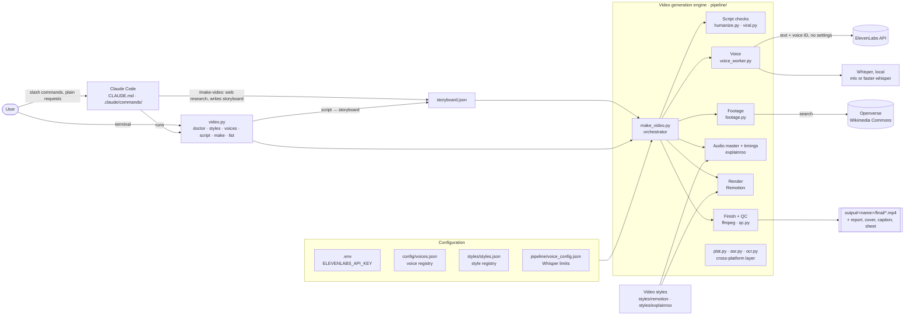

# Diagram 1: overall system architecture

Everything inside the engine box runs on your computer. The outside services are ElevenLabs (narration), the footage
search for footage-based styles, and Claude (through Claude Code) for `/make-video` research and writing.
