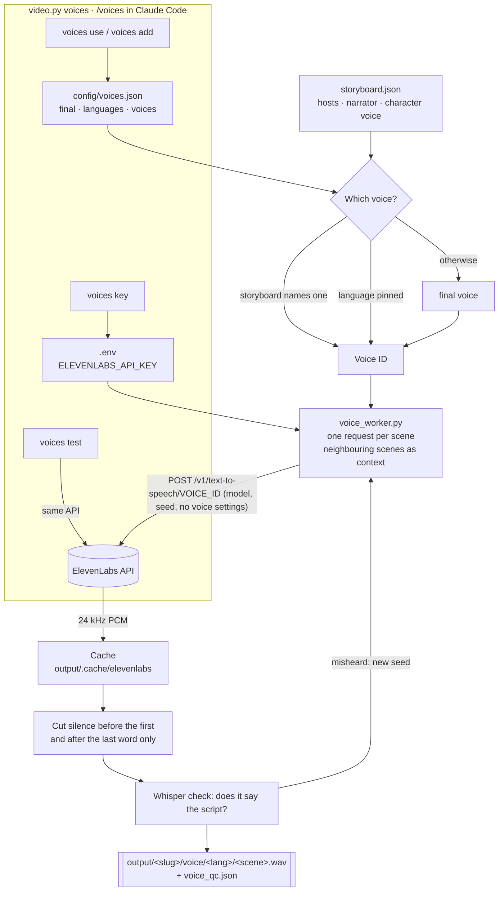

# Diagram 3: voice generation workflow

The key is read from `.env` at the moment of the request and is never written to logs, reports or the browser.
The audio is used exactly as delivered: no speed, pause, pitch or EQ change.
A take is cached by voice, model, text, context and seed, so re-running a video does not spend credits again.
