# Video styles

> Generated from [`styles/styles.json`](../styles/styles.json) by `pipeline/styles_doc.py`. Edit the registry, then run
> `python3 video.py styles-doc` (Windows: `py video.py styles-doc`).

27 styles, all 1080×1920 (9:16) at 30 fps. Click a picture to watch that style's preview (`samples/styles/<style>.mp4`).
When no style is given, `video.py script` uses `edtech`.

**Commands for any style** (replace `STYLE`; on Windows write `py` instead of `python3`):

| Where | Command |
|---|---|
| Terminal, your own script | `python3 video.py script my-script.txt --title "My video" --style STYLE` |
| Terminal, a storyboard JSON | `python3 video.py make my-storyboard.json --style STYLE` |
| Claude Code, your own script | `/video-from-script my-script.txt --style STYLE` |
| Claude Code, topic (AI writes the script) | `/make-video What is an API 60s --style STYLE` |
| List styles in the terminal | `python3 video.py styles` |

Add `--mode fast` for a quick draft, `--lang hi` (Hindi) or `--lang hl` (Hinglish) for other languages.

## Gallery

**Explainer**

| [`edtech`](#edtech) |
|---|
| [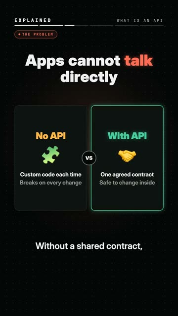](../samples/styles/edtech.mp4) |

**Documentary**

| [`documentary-history`](#documentary-history) |
|---|
| [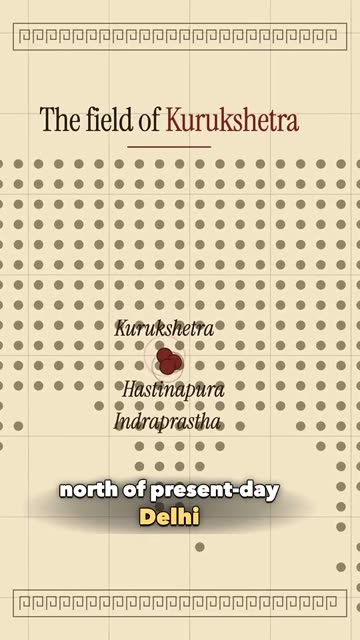](../samples/styles/documentary-history.mp4) |

**Real footage**

| [`real-footage`](#real-footage) |
|---|
| [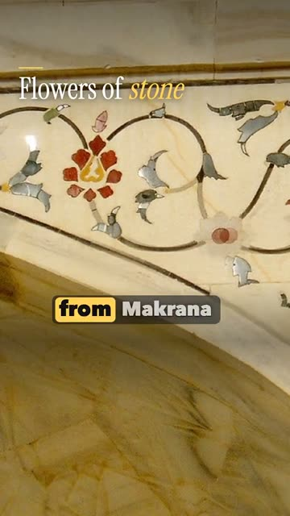](../samples/styles/real-footage.mp4) |

**Story & characters**

| [`character-story`](#character-story) |
|---|
| [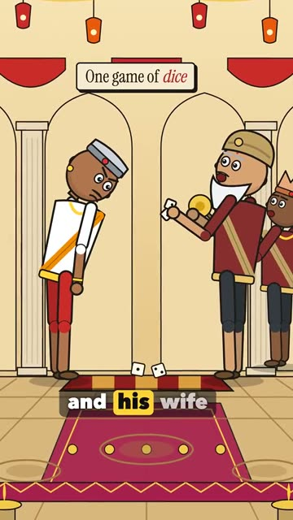](../samples/styles/character-story.mp4) |

**Text/typography**

| [`kinetic-typography`](#kinetic-typography) | [`typewriter-terminal`](#typewriter-terminal) | [`glitch-vhs`](#glitch-vhs) | [`neon-glow`](#neon-glow) | [`comic-book`](#comic-book) |
|---|---|---|---|---|
| [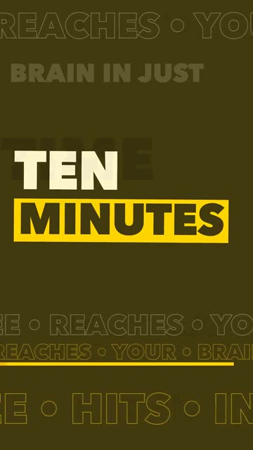](../samples/styles/kinetic-typography.mp4) | [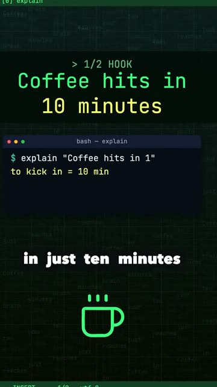](../samples/styles/typewriter-terminal.mp4) | [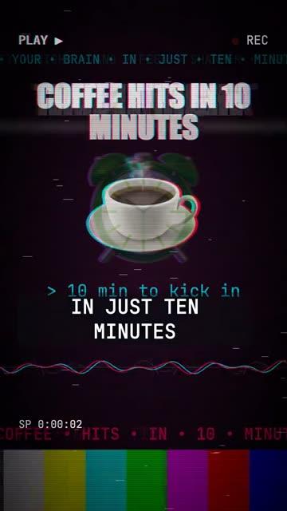](../samples/styles/glitch-vhs.mp4) | [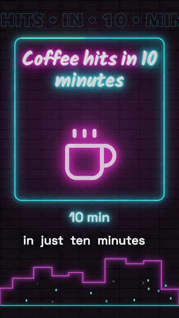](../samples/styles/neon-glow.mp4) | [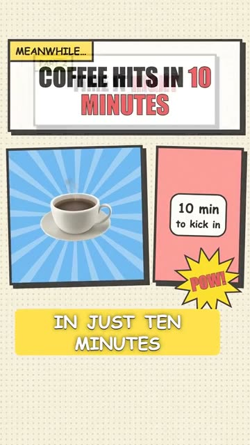](../samples/styles/comic-book.mp4) |

**Illustration/hand-drawn**

| [`whiteboard`](#whiteboard) | [`chalkboard`](#chalkboard) | [`notebook-doodle`](#notebook-doodle) | [`line-art`](#line-art) | [`paper-cutout`](#paper-cutout) |
|---|---|---|---|---|
| [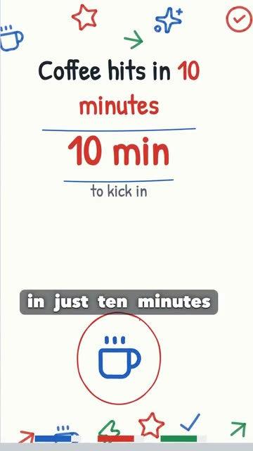](../samples/styles/whiteboard.mp4) | [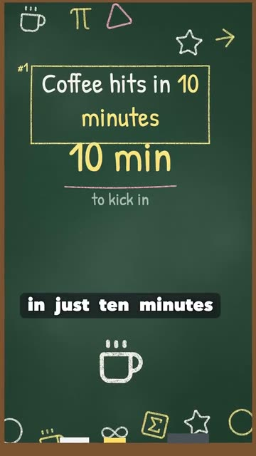](../samples/styles/chalkboard.mp4) | [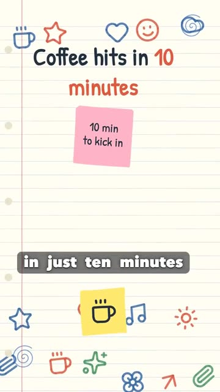](../samples/styles/notebook-doodle.mp4) | [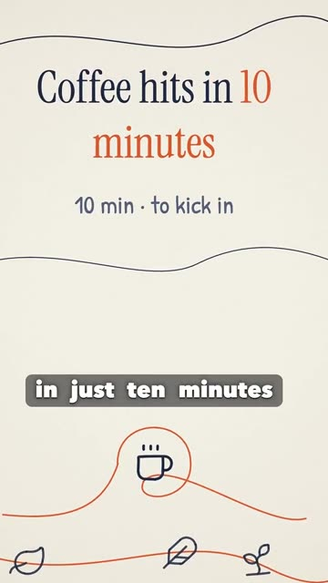](../samples/styles/line-art.mp4) | [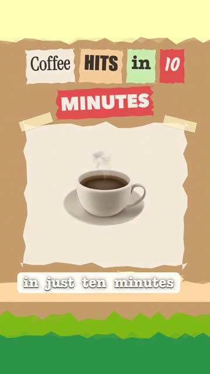](../samples/styles/paper-cutout.mp4) |

**Flat & motion graphics**

| [`flat-icons`](#flat-icons) | [`isometric`](#isometric) | [`gradient-blob`](#gradient-blob) | [`neumorphism`](#neumorphism) | [`particle-dots`](#particle-dots) |
|---|---|---|---|---|
| [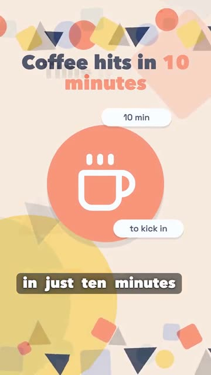](../samples/styles/flat-icons.mp4) | [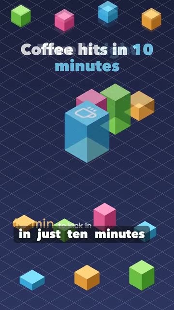](../samples/styles/isometric.mp4) | [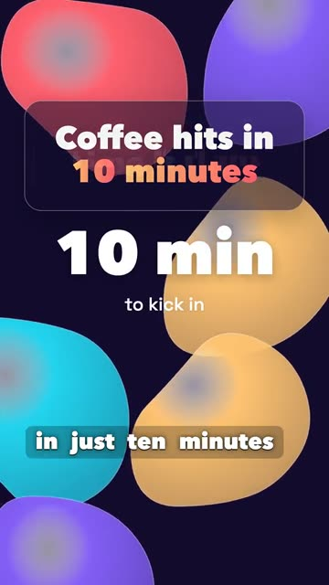](../samples/styles/gradient-blob.mp4) | [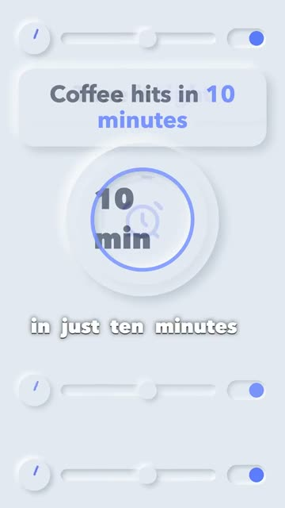](../samples/styles/neumorphism.mp4) | [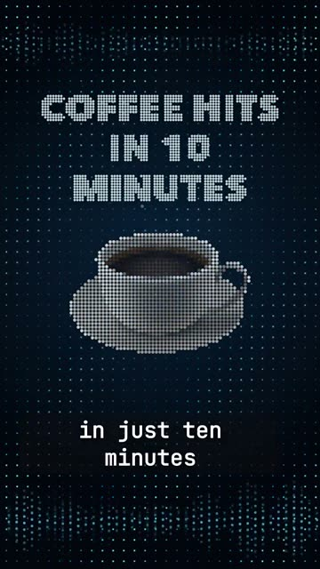](../samples/styles/particle-dots.mp4) |

**Data & infographic**

| [`bar-pie-chart`](#bar-pie-chart) | [`timeline-roadmap`](#timeline-roadmap) | [`number-ticker`](#number-ticker) | [`map-geo-pins`](#map-geo-pins) | [`split-screen`](#split-screen) |
|---|---|---|---|---|
| [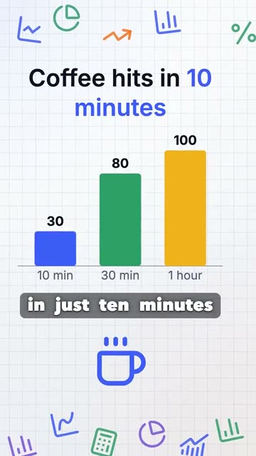](../samples/styles/bar-pie-chart.mp4) | [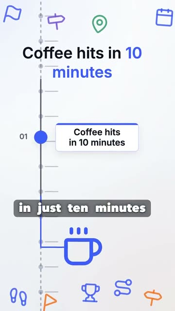](../samples/styles/timeline-roadmap.mp4) | [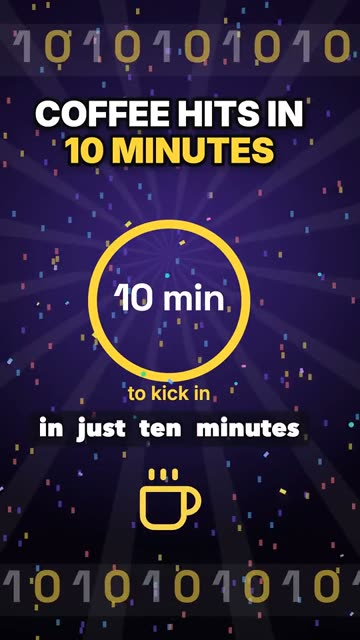](../samples/styles/number-ticker.mp4) | [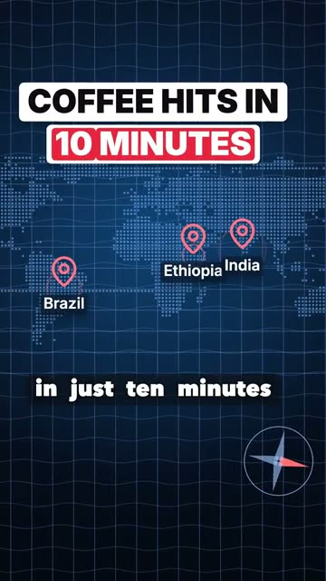](../samples/styles/map-geo-pins.mp4) | [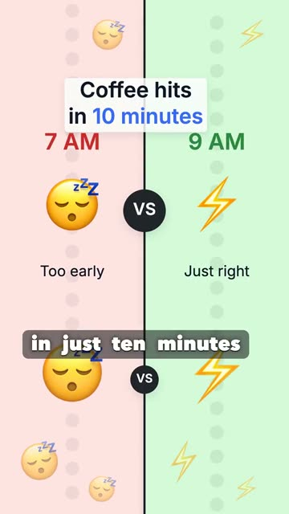](../samples/styles/split-screen.mp4) |

**Retro & novelty**

| [`pixel-art`](#pixel-art) | [`emoji-pop`](#emoji-pop) | [`old-film`](#old-film) |
|---|---|---|
| [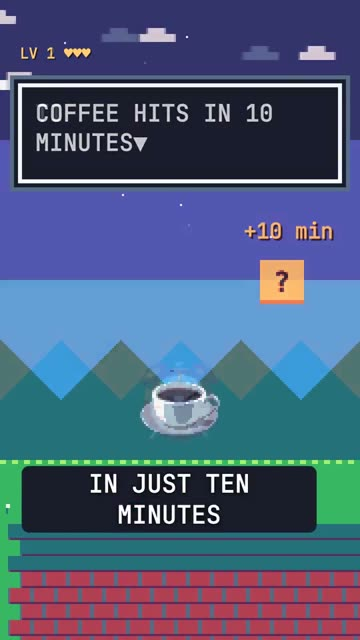](../samples/styles/pixel-art.mp4) | [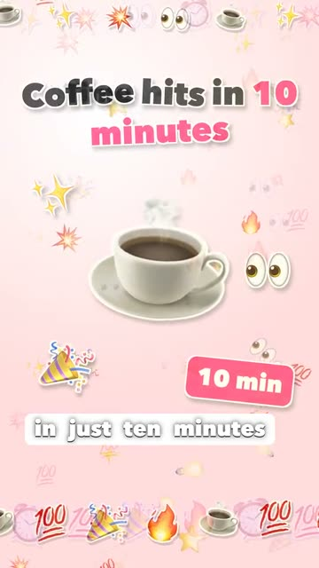](../samples/styles/emoji-pop.mp4) | [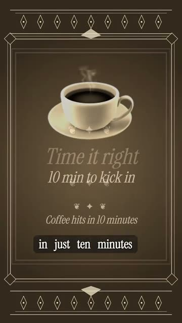](../samples/styles/old-film.mp4) |

## Every style, with its commands

### Explainer

#### edtech

<a href="../samples/styles/edtech.mp4"></a>

**EDTech (system-design canvas)**: Dark system-design canvas from the MCP / RAG / UPI reels: chapter chip and tint per role, glowing cards that pop on cue, counters, VS cards, bar rows, numbered flows, comment-box CTA, word-by-word captions.

- **Best for:** Tech and concept explainers, interview-style questions, step-by-step teaching
- **Engine:** remotion · **music bed:** tech · **source:** `styles/remotion/src/styles/`
- **Storyboard fields it reads:** role (hook|problem|payoff|cta) + headline (*keywords*), then one of: items | stat | compare | chart | steps, else emoji/icon + sub
- **Assets:** Inter and JetBrains Mono fonts (bundled in styles/remotion/public/fonts)
- **Preview video:** [`samples/styles/edtech.mp4`](../samples/styles/edtech.mp4) · **example storyboard:** [`examples/storyboards/edtech.json`](../examples/storyboards/edtech.json)
- **QC not applied:** `balance`: a dark, minimal canvas with a few glowing cards is the design; the band-detail measure reads its deliberate negative space as empty

```bash
# your own script
python3 video.py script my-script.txt --title "My video" --style edtech
# the example storyboard (a quick test)
python3 video.py make examples/storyboards/edtech.json --style edtech --mode fast --allow-lint-fail --name try-edtech
```

In Claude Code:

```text
/video-from-script my-script.txt --style edtech
/make-video <your topic> 60s --style edtech
```

<br clear="right">

### Documentary

#### documentary-history

<a href="../samples/styles/documentary-history.mp4"></a>

**Documentary history (smart-switching)**: Cuts like a real documentary: crisp archival photos/clips with a subtle period colour grade, parchment maps with wax-seal pins, ink timelines, and short dramatized character reenactments; serif parchment captions.

- **Best for:** History and biography: mixes archive footage, maps, timelines and reenactments
- **Engine:** explainroo · **music bed:** calm · **source:** `styles/explainroo/documentary-history/`
- **Storyboard fields it reads:** per-scene visual: footage (+footage queries) | map (places) | timeline (steps) | reenact (stage + characters); measured narration
- **Assets:** Same footage search as real-footage; maps and timelines are drawn
- **Preview video:** [`samples/styles/documentary-history.mp4`](../samples/styles/documentary-history.mp4) · **example storyboard:** [`examples/storyboards/documentary.json`](../examples/storyboards/documentary.json)

```bash
# your own script
python3 video.py script my-script.txt --title "My video" --style documentary-history
# the example storyboard (a quick test)
python3 video.py make examples/storyboards/documentary.json --style documentary-history --mode fast --allow-lint-fail --name try-documentary-history
```

In Claude Code:

```text
/video-from-script my-script.txt --style documentary-history
/make-video <your topic> 60s --style documentary-history
```

<br clear="right">

### Real footage

#### real-footage

<a href="../samples/styles/real-footage.mp4"></a>

**Real footage / documentary**: Licensed photos/clips (Openverse, Wikimedia Commons) matched to each line, Ken Burns + depth parallax, documentary titles.

- **Best for:** News, places, people and modern events that real photos or clips can show
- **Engine:** remotion · **music bed:** calm · **source:** `styles/remotion/src/styles/`
- **Storyboard fields it reads:** footage {queries, subject, keywords, prefer} per scene
- **Assets:** Licensed photos/clips fetched per video from Openverse and Wikimedia Commons (internet needed)
- **Preview video:** [`samples/styles/real-footage.mp4`](../samples/styles/real-footage.mp4) · **example storyboard:** [`examples/storyboards/real-footage.json`](../examples/storyboards/real-footage.json)

```bash
# your own script
python3 video.py script my-script.txt --title "My video" --style real-footage
# the example storyboard (a quick test)
python3 video.py make examples/storyboards/real-footage.json --style real-footage --mode fast --allow-lint-fail --name try-real-footage
```

In Claude Code:

```text
/video-from-script my-script.txt --style real-footage
/make-video <your topic> 60s --style real-footage
```

<br clear="right">

### Story & characters

#### character-story

<a href="../samples/styles/character-story.mp4"></a>

**Character story (2D cutout)**: Original 2D cutout puppets act the story: 23 poses tweened on cue, walks, lip-flap on the speaker, 7 illustrated sets, camera push/pan with parallax.

- **Best for:** Stories and mythology where named characters act out a scene
- **Engine:** remotion · **music bed:** calm · **source:** `styles/remotion/src/styles/`
- **Storyboard fields it reads:** characters [{id,name,description,voice}] + per-scene stage {background, camera, set, cast[{id,x,pose,actions,walk,facing,depth}], speaker}
- **Assets:** None: everything is drawn in code
- **Preview video:** [`samples/styles/character-story.mp4`](../samples/styles/character-story.mp4) · **example storyboard:** [`examples/storyboards/character-story.json`](../examples/storyboards/character-story.json)

```bash
# your own script
python3 video.py script my-script.txt --title "My video" --style character-story
# the example storyboard (a quick test)
python3 video.py make examples/storyboards/character-story.json --style character-story --mode fast --allow-lint-fail --name try-character-story
```

In Claude Code:

```text
/video-from-script my-script.txt --style character-story
/make-video <your topic> 60s --style character-story
```

<br clear="right">

### Text/typography

#### kinetic-typography

<a href="../samples/styles/kinetic-typography.mp4"></a>

**Kinetic Typography**: Bold word-by-word reveal of the narration itself, huge type on flipping colour blocks.

- **Best for:** Punchy opinion or fact videos where the words are the picture
- **Engine:** remotion · **music bed:** upbeat · **source:** `styles/remotion/src/styles/`
- **Storyboard fields it reads:** headline (*keywords*)
- **Assets:** None: everything is drawn in code
- **Preview video:** [`samples/styles/kinetic-typography.mp4`](../samples/styles/kinetic-typography.mp4) · **example storyboard:** [`examples/storyboards/sample.json`](../examples/storyboards/sample.json)

```bash
# your own script
python3 video.py script my-script.txt --title "My video" --style kinetic-typography
# the example storyboard (a quick test)
python3 video.py make examples/storyboards/sample.json --style kinetic-typography --mode fast --allow-lint-fail --name try-kinetic-typography
```

In Claude Code:

```text
/video-from-script my-script.txt --style kinetic-typography
/make-video <your topic> 60s --style kinetic-typography
```

<br clear="right">

#### typewriter-terminal

<a href="../samples/styles/typewriter-terminal.mp4"></a>

**Typewriter Terminal**: Green-on-black CRT terminal: headline types out, a bash window prints the points.

- **Best for:** Developer and command-line topics
- **Engine:** explainroo · **music bed:** tech · **source:** `styles/explainroo/typewriter-terminal/`
- **Storyboard fields it reads:** headline, items, stat
- **Assets:** None: everything is drawn in code
- **Preview video:** [`samples/styles/typewriter-terminal.mp4`](../samples/styles/typewriter-terminal.mp4) · **example storyboard:** [`examples/storyboards/sample.json`](../examples/storyboards/sample.json)

```bash
# your own script
python3 video.py script my-script.txt --title "My video" --style typewriter-terminal
# the example storyboard (a quick test)
python3 video.py make examples/storyboards/sample.json --style typewriter-terminal --mode fast --allow-lint-fail --name try-typewriter-terminal
```

In Claude Code:

```text
/video-from-script my-script.txt --style typewriter-terminal
/make-video <your topic> 60s --style typewriter-terminal
```

<br clear="right">

#### glitch-vhs

<a href="../samples/styles/glitch-vhs.mp4"></a>

**Glitch Vhs**: RGB-split glitch text, slice displacement, scanlines, tracking noise, PLAY/REC VHS overlay.

- **Best for:** Gaming, internet culture, edgy tech takes
- **Engine:** remotion · **music bed:** tech · **source:** `styles/remotion/src/styles/`
- **Storyboard fields it reads:** headline, emoji, stat
- **Assets:** None: everything is drawn in code
- **Preview video:** [`samples/styles/glitch-vhs.mp4`](../samples/styles/glitch-vhs.mp4) · **example storyboard:** [`examples/storyboards/sample.json`](../examples/storyboards/sample.json)

```bash
# your own script
python3 video.py script my-script.txt --title "My video" --style glitch-vhs
# the example storyboard (a quick test)
python3 video.py make examples/storyboards/sample.json --style glitch-vhs --mode fast --allow-lint-fail --name try-glitch-vhs
```

In Claude Code:

```text
/video-from-script my-script.txt --style glitch-vhs
/make-video <your topic> 60s --style glitch-vhs
```

<br clear="right">

#### neon-glow

<a href="../samples/styles/neon-glow.mp4"></a>

**Neon Glow**: Flickering neon-tube text and outline icon on a dark brick wall, frame draws itself.

- **Best for:** Night-life, music and bold announcements
- **Engine:** remotion · **music bed:** tech · **source:** `styles/remotion/src/styles/`
- **Storyboard fields it reads:** headline, icon, stat
- **Assets:** None: everything is drawn in code
- **Preview video:** [`samples/styles/neon-glow.mp4`](../samples/styles/neon-glow.mp4) · **example storyboard:** [`examples/storyboards/sample.json`](../examples/storyboards/sample.json)

```bash
# your own script
python3 video.py script my-script.txt --title "My video" --style neon-glow
# the example storyboard (a quick test)
python3 video.py make examples/storyboards/sample.json --style neon-glow --mode fast --allow-lint-fail --name try-neon-glow
```

In Claude Code:

```text
/video-from-script my-script.txt --style neon-glow
/make-video <your topic> 60s --style neon-glow
```

<br clear="right">

#### comic-book

<a href="../samples/styles/comic-book.mp4"></a>

**Comic Book**: Halftone page, panels slam in, yellow caption boxes, speech bubble, POW/BAM bursts.

- **Best for:** Fun facts, listicles, pop-culture trivia
- **Engine:** remotion · **music bed:** upbeat · **source:** `styles/remotion/src/styles/`
- **Storyboard fields it reads:** headline, emoji, stat/items
- **Assets:** None: everything is drawn in code
- **Preview video:** [`samples/styles/comic-book.mp4`](../samples/styles/comic-book.mp4) · **example storyboard:** [`examples/storyboards/sample.json`](../examples/storyboards/sample.json)

```bash
# your own script
python3 video.py script my-script.txt --title "My video" --style comic-book
# the example storyboard (a quick test)
python3 video.py make examples/storyboards/sample.json --style comic-book --mode fast --allow-lint-fail --name try-comic-book
```

In Claude Code:

```text
/video-from-script my-script.txt --style comic-book
/make-video <your topic> 60s --style comic-book
```

<br clear="right">

### Illustration/hand-drawn

#### whiteboard

<a href="../samples/styles/whiteboard.mp4"></a>

**Whiteboard**: Dry-erase marker sketch on a whiteboard: lines draw, circles and underlines on cue.

- **Best for:** Classroom-style explanations and how-tos
- **Engine:** explainroo · **music bed:** warm · **source:** `styles/explainroo/whiteboard/`
- **Storyboard fields it reads:** headline, icon, stat or items
- **Assets:** None: everything is drawn in code
- **Preview video:** [`samples/styles/whiteboard.mp4`](../samples/styles/whiteboard.mp4) · **example storyboard:** [`examples/storyboards/sample.json`](../examples/storyboards/sample.json)

```bash
# your own script
python3 video.py script my-script.txt --title "My video" --style whiteboard
# the example storyboard (a quick test)
python3 video.py make examples/storyboards/sample.json --style whiteboard --mode fast --allow-lint-fail --name try-whiteboard
```

In Claude Code:

```text
/video-from-script my-script.txt --style whiteboard
/make-video <your topic> 60s --style whiteboard
```

<br clear="right">

#### chalkboard

<a href="../samples/styles/chalkboard.mp4"></a>

**Chalkboard**: Chalk writing on a green board in a wooden frame, boxed headline, chalk doodles.

- **Best for:** School subjects, maths and science basics
- **Engine:** explainroo · **music bed:** calm · **source:** `styles/explainroo/chalkboard/`
- **Storyboard fields it reads:** headline, icon, items or stat
- **Assets:** None: everything is drawn in code
- **Preview video:** [`samples/styles/chalkboard.mp4`](../samples/styles/chalkboard.mp4) · **example storyboard:** [`examples/storyboards/sample.json`](../examples/storyboards/sample.json)

```bash
# your own script
python3 video.py script my-script.txt --title "My video" --style chalkboard
# the example storyboard (a quick test)
python3 video.py make examples/storyboards/sample.json --style chalkboard --mode fast --allow-lint-fail --name try-chalkboard
```

In Claude Code:

```text
/video-from-script my-script.txt --style chalkboard
/make-video <your topic> 60s --style chalkboard
```

<br clear="right">

#### notebook-doodle

<a href="../samples/styles/notebook-doodle.mp4"></a>

**Notebook Doodle**: Ruled notebook page with red margin, coloured sticky notes drop in, pen doodles.

- **Best for:** Study tips, personal notes, light tutorials
- **Engine:** explainroo · **music bed:** warm · **source:** `styles/explainroo/notebook-doodle/`
- **Storyboard fields it reads:** headline, icon, items or stat
- **Assets:** None: everything is drawn in code
- **Preview video:** [`samples/styles/notebook-doodle.mp4`](../samples/styles/notebook-doodle.mp4) · **example storyboard:** [`examples/storyboards/sample.json`](../examples/storyboards/sample.json)

```bash
# your own script
python3 video.py script my-script.txt --title "My video" --style notebook-doodle
# the example storyboard (a quick test)
python3 video.py make examples/storyboards/sample.json --style notebook-doodle --mode fast --allow-lint-fail --name try-notebook-doodle
```

In Claude Code:

```text
/video-from-script my-script.txt --style notebook-doodle
/make-video <your topic> 60s --style notebook-doodle
```

<br clear="right">

#### line-art

<a href="../samples/styles/line-art.mp4"></a>

**Line Art**: One continuous ink line strokes across the page and loops round a self-tracing icon.

- **Best for:** Calm, minimal concept explainers
- **Engine:** explainroo · **music bed:** calm · **source:** `styles/explainroo/line-art/`
- **Storyboard fields it reads:** headline, icon, stat or items
- **Assets:** None: everything is drawn in code
- **Preview video:** [`samples/styles/line-art.mp4`](../samples/styles/line-art.mp4) · **example storyboard:** [`examples/storyboards/sample.json`](../examples/storyboards/sample.json)

```bash
# your own script
python3 video.py script my-script.txt --title "My video" --style line-art
# the example storyboard (a quick test)
python3 video.py make examples/storyboards/sample.json --style line-art --mode fast --allow-lint-fail --name try-line-art
```

In Claude Code:

```text
/video-from-script my-script.txt --style line-art
/make-video <your topic> 60s --style line-art
```

<br clear="right">

#### paper-cutout

<a href="../samples/styles/paper-cutout.mp4"></a>

**Paper Cutout**: Kraft-board collage: torn paper scraps, ransom-note words, tape, 12 fps stop-motion.

- **Best for:** Craft, lifestyle and playful storytelling
- **Engine:** remotion · **music bed:** warm · **source:** `styles/remotion/src/styles/`
- **Storyboard fields it reads:** headline, emoji, stat
- **Assets:** None: everything is drawn in code
- **Preview video:** [`samples/styles/paper-cutout.mp4`](../samples/styles/paper-cutout.mp4) · **example storyboard:** [`examples/storyboards/sample.json`](../examples/storyboards/sample.json)

```bash
# your own script
python3 video.py script my-script.txt --title "My video" --style paper-cutout
# the example storyboard (a quick test)
python3 video.py make examples/storyboards/sample.json --style paper-cutout --mode fast --allow-lint-fail --name try-paper-cutout
```

In Claude Code:

```text
/video-from-script my-script.txt --style paper-cutout
/make-video <your topic> 60s --style paper-cutout
```

<br clear="right">

### Flat & motion graphics

#### flat-icons

<a href="../samples/styles/flat-icons.mp4"></a>

**Flat Icons**: Minimal flat shapes slide in, icon bounces in a circle, chips orbit it.

- **Best for:** Product tips, app features, clean corporate explainers
- **Engine:** remotion · **music bed:** upbeat · **source:** `styles/remotion/src/styles/`
- **Storyboard fields it reads:** headline, icon, items/stat
- **Assets:** None: everything is drawn in code
- **Preview video:** [`samples/styles/flat-icons.mp4`](../samples/styles/flat-icons.mp4) · **example storyboard:** [`examples/storyboards/sample.json`](../examples/storyboards/sample.json)

```bash
# your own script
python3 video.py script my-script.txt --title "My video" --style flat-icons
# the example storyboard (a quick test)
python3 video.py make examples/storyboards/sample.json --style flat-icons --mode fast --allow-lint-fail --name try-flat-icons
```

In Claude Code:

```text
/video-from-script my-script.txt --style flat-icons
/make-video <your topic> 60s --style flat-icons
```

<br clear="right">

#### isometric

<a href="../samples/styles/isometric.mp4"></a>

**Isometric**: Isometric grid floor, blocks rise to data heights, icon on the top face.

- **Best for:** Systems, comparisons and data with a 3D feel
- **Engine:** remotion · **music bed:** tech · **source:** `styles/remotion/src/styles/`
- **Storyboard fields it reads:** headline, icon, chart/items, stat
- **Assets:** None: everything is drawn in code
- **Preview video:** [`samples/styles/isometric.mp4`](../samples/styles/isometric.mp4) · **example storyboard:** [`examples/storyboards/sample.json`](../examples/storyboards/sample.json)

```bash
# your own script
python3 video.py script my-script.txt --title "My video" --style isometric
# the example storyboard (a quick test)
python3 video.py make examples/storyboards/sample.json --style isometric --mode fast --allow-lint-fail --name try-isometric
```

In Claude Code:

```text
/video-from-script my-script.txt --style isometric
/make-video <your topic> 60s --style isometric
```

<br clear="right">

#### gradient-blob

<a href="../samples/styles/gradient-blob.mp4"></a>

**Gradient Blob**: Morphing blurred colour blobs behind a frosted-glass card, big stat count-up.

- **Best for:** Single big statistic or modern brand-style statement
- **Engine:** remotion · **music bed:** calm · **source:** `styles/remotion/src/styles/`
- **Storyboard fields it reads:** headline, icon, stat
- **Assets:** None: everything is drawn in code
- **Preview video:** [`samples/styles/gradient-blob.mp4`](../samples/styles/gradient-blob.mp4) · **example storyboard:** [`examples/storyboards/sample.json`](../examples/storyboards/sample.json)

```bash
# your own script
python3 video.py script my-script.txt --title "My video" --style gradient-blob
# the example storyboard (a quick test)
python3 video.py make examples/storyboards/sample.json --style gradient-blob --mode fast --allow-lint-fail --name try-gradient-blob
```

In Claude Code:

```text
/video-from-script my-script.txt --style gradient-blob
/make-video <your topic> 60s --style gradient-blob
```

<br clear="right">

#### neumorphism

<a href="../samples/styles/neumorphism.mp4"></a>

**Neumorphism**: Soft-UI cards with dual shadows, items press in on cue, inset progress ring.

- **Best for:** Checklists and soft, app-like product explainers
- **Engine:** remotion · **music bed:** calm · **source:** `styles/remotion/src/styles/`
- **Storyboard fields it reads:** headline, icon/stat, items
- **Assets:** None: everything is drawn in code
- **Preview video:** [`samples/styles/neumorphism.mp4`](../samples/styles/neumorphism.mp4) · **example storyboard:** [`examples/storyboards/sample.json`](../examples/storyboards/sample.json)

```bash
# your own script
python3 video.py script my-script.txt --title "My video" --style neumorphism
# the example storyboard (a quick test)
python3 video.py make examples/storyboards/sample.json --style neumorphism --mode fast --allow-lint-fail --name try-neumorphism
```

In Claude Code:

```text
/video-from-script my-script.txt --style neumorphism
/make-video <your topic> 60s --style neumorphism
```

<br clear="right">

#### particle-dots

<a href="../samples/styles/particle-dots.mp4"></a>

**Particle Dots**: Thousands of dots fly in from noise and lock into the headline and emoji.

- **Best for:** Dramatic reveals and one-line statements
- **Engine:** remotion · **music bed:** tech · **source:** `styles/remotion/src/styles/`
- **Storyboard fields it reads:** headline, emoji
- **Assets:** None: everything is drawn in code
- **Preview video:** [`samples/styles/particle-dots.mp4`](../samples/styles/particle-dots.mp4) · **example storyboard:** [`examples/storyboards/sample.json`](../examples/storyboards/sample.json)

```bash
# your own script
python3 video.py script my-script.txt --title "My video" --style particle-dots
# the example storyboard (a quick test)
python3 video.py make examples/storyboards/sample.json --style particle-dots --mode fast --allow-lint-fail --name try-particle-dots
```

In Claude Code:

```text
/video-from-script my-script.txt --style particle-dots
/make-video <your topic> 60s --style particle-dots
```

<br clear="right">

### Data & infographic

#### bar-pie-chart

<a href="../samples/styles/bar-pie-chart.mp4"></a>

**Bar Pie Chart**: Bars grow or a donut sweeps in on cue with ticking values.

- **Best for:** Comparing numbers: rankings, shares, before and after
- **Engine:** explainroo · **music bed:** upbeat · **source:** `styles/explainroo/bar-pie-chart/`
- **Storyboard fields it reads:** chart {type bar|pie, items}
- **Assets:** None: everything is drawn in code
- **Preview video:** [`samples/styles/bar-pie-chart.mp4`](../samples/styles/bar-pie-chart.mp4) · **example storyboard:** [`examples/storyboards/sample.json`](../examples/storyboards/sample.json)

```bash
# your own script
python3 video.py script my-script.txt --title "My video" --style bar-pie-chart
# the example storyboard (a quick test)
python3 video.py make examples/storyboards/sample.json --style bar-pie-chart --mode fast --allow-lint-fail --name try-bar-pie-chart
```

In Claude Code:

```text
/video-from-script my-script.txt --style bar-pie-chart
/make-video <your topic> 60s --style bar-pie-chart
```

<br clear="right">

#### timeline-roadmap

<a href="../samples/styles/timeline-roadmap.mp4"></a>

**Timeline Roadmap**: A vertical road draws down the frame; milestones pop in one by one.

- **Best for:** Histories, roadmaps and step sequences with dates
- **Engine:** explainroo · **music bed:** calm · **source:** `styles/explainroo/timeline-roadmap/`
- **Storyboard fields it reads:** steps [{date,label}] or items
- **Assets:** None: everything is drawn in code
- **Preview video:** [`samples/styles/timeline-roadmap.mp4`](../samples/styles/timeline-roadmap.mp4) · **example storyboard:** [`examples/storyboards/sample.json`](../examples/storyboards/sample.json)

```bash
# your own script
python3 video.py script my-script.txt --title "My video" --style timeline-roadmap
# the example storyboard (a quick test)
python3 video.py make examples/storyboards/sample.json --style timeline-roadmap --mode fast --allow-lint-fail --name try-timeline-roadmap
```

In Claude Code:

```text
/video-from-script my-script.txt --style timeline-roadmap
/make-video <your topic> 60s --style timeline-roadmap
```

<br clear="right">

#### number-ticker

<a href="../samples/styles/number-ticker.mp4"></a>

**Number Ticker**: Giant number counts up inside a filling ring on a rays backdrop, confetti on landing.

- **Best for:** One headline number that should land hard
- **Engine:** explainroo · **music bed:** tech · **source:** `styles/explainroo/number-ticker/`
- **Storyboard fields it reads:** stat {value,prefix,suffix,label}
- **Assets:** None: everything is drawn in code
- **Preview video:** [`samples/styles/number-ticker.mp4`](../samples/styles/number-ticker.mp4) · **example storyboard:** [`examples/storyboards/sample.json`](../examples/storyboards/sample.json)

```bash
# your own script
python3 video.py script my-script.txt --title "My video" --style number-ticker
# the example storyboard (a quick test)
python3 video.py make examples/storyboards/sample.json --style number-ticker --mode fast --allow-lint-fail --name try-number-ticker
```

In Claude Code:

```text
/video-from-script my-script.txt --style number-ticker
/make-video <your topic> 60s --style number-ticker
```

<br clear="right">

#### map-geo-pins

<a href="../samples/styles/map-geo-pins.mp4"></a>

**Map Geo Pins**: Natural-Earth dot-matrix map framed on the places; pins drop with pulsing rings.

- **Best for:** Stories tied to places: travel, geography, logistics
- **Engine:** explainroo · **music bed:** calm · **source:** `styles/explainroo/map-geo-pins/`
- **Storyboard fields it reads:** places [{name,lat,lon}]
- **Assets:** Natural Earth map data bundled with explainroo
- **Preview video:** [`samples/styles/map-geo-pins.mp4`](../samples/styles/map-geo-pins.mp4) · **example storyboard:** [`examples/storyboards/sample.json`](../examples/storyboards/sample.json)

```bash
# your own script
python3 video.py script my-script.txt --title "My video" --style map-geo-pins
# the example storyboard (a quick test)
python3 video.py make examples/storyboards/sample.json --style map-geo-pins --mode fast --allow-lint-fail --name try-map-geo-pins
```

In Claude Code:

```text
/video-from-script my-script.txt --style map-geo-pins
/make-video <your topic> 60s --style map-geo-pins
```

<br clear="right">

#### split-screen

<a href="../samples/styles/split-screen.mp4"></a>

**Split Screen**: Frame splits in two coloured halves, sides slam in, a VS badge pops between.

- **Best for:** Two-sided comparisons: A versus B
- **Engine:** explainroo · **music bed:** upbeat · **source:** `styles/explainroo/split-screen/`
- **Storyboard fields it reads:** compare {left,right:{title,emoji,points}}
- **Assets:** None: everything is drawn in code
- **Preview video:** [`samples/styles/split-screen.mp4`](../samples/styles/split-screen.mp4) · **example storyboard:** [`examples/storyboards/sample.json`](../examples/storyboards/sample.json)

```bash
# your own script
python3 video.py script my-script.txt --title "My video" --style split-screen
# the example storyboard (a quick test)
python3 video.py make examples/storyboards/sample.json --style split-screen --mode fast --allow-lint-fail --name try-split-screen
```

In Claude Code:

```text
/video-from-script my-script.txt --style split-screen
/make-video <your topic> 60s --style split-screen
```

<br clear="right">

### Retro & novelty

#### pixel-art

<a href="../samples/styles/pixel-art.mp4"></a>

**Pixel Art**: 180x320 canvas quantised to a 16-colour palette, scaled 6x, RPG dialogue box.

- **Best for:** Retro gaming and nostalgic topics
- **Engine:** remotion · **music bed:** upbeat · **source:** `styles/remotion/src/styles/`
- **Storyboard fields it reads:** headline, emoji, stat
- **Assets:** None: everything is drawn in code
- **Preview video:** [`samples/styles/pixel-art.mp4`](../samples/styles/pixel-art.mp4) · **example storyboard:** [`examples/storyboards/sample.json`](../examples/storyboards/sample.json)

```bash
# your own script
python3 video.py script my-script.txt --title "My video" --style pixel-art
# the example storyboard (a quick test)
python3 video.py make examples/storyboards/sample.json --style pixel-art --mode fast --allow-lint-fail --name try-pixel-art
```

In Claude Code:

```text
/video-from-script my-script.txt --style pixel-art
/make-video <your topic> 60s --style pixel-art
```

<br clear="right">

#### emoji-pop

<a href="../samples/styles/emoji-pop.mp4"></a>

**Emoji Pop**: Die-cut sticker words and emoji pop with elastic springs, emoji confetti rain.

- **Best for:** Light, upbeat social content
- **Engine:** remotion · **music bed:** upbeat · **source:** `styles/remotion/src/styles/`
- **Storyboard fields it reads:** headline, emoji, stat
- **Assets:** None: everything is drawn in code
- **Preview video:** [`samples/styles/emoji-pop.mp4`](../samples/styles/emoji-pop.mp4) · **example storyboard:** [`examples/storyboards/sample.json`](../examples/storyboards/sample.json)

```bash
# your own script
python3 video.py script my-script.txt --title "My video" --style emoji-pop
# the example storyboard (a quick test)
python3 video.py make examples/storyboards/sample.json --style emoji-pop --mode fast --allow-lint-fail --name try-emoji-pop
```

In Claude Code:

```text
/video-from-script my-script.txt --style emoji-pop
/make-video <your topic> 60s --style emoji-pop
```

<br clear="right">

#### old-film

<a href="../samples/styles/old-film.mp4"></a>

**Old Film**: Sepia silent-film intertitle cards and sepia-graded shots in an Art-Deco frame; the period feel comes from colour and typography, everything stays sharp.

- **Best for:** Vintage stories and 'back in the day' facts
- **Engine:** remotion · **music bed:** calm · **source:** `styles/remotion/src/styles/`
- **Storyboard fields it reads:** headline, emoji, stat
- **Assets:** None: everything is drawn in code
- **Preview video:** [`samples/styles/old-film.mp4`](../samples/styles/old-film.mp4) · **example storyboard:** [`examples/storyboards/sample.json`](../examples/storyboards/sample.json)

```bash
# your own script
python3 video.py script my-script.txt --title "My video" --style old-film
# the example storyboard (a quick test)
python3 video.py make examples/storyboards/sample.json --style old-film --mode fast --allow-lint-fail --name try-old-film
```

In Claude Code:

```text
/video-from-script my-script.txt --style old-film
/make-video <your topic> 60s --style old-film
```

<br clear="right">

## Layout rules every style follows

- Frame 1080×1920. Keep words inside the safe area: nothing important in the top 100 px or the bottom 24% (the Reels/Shorts interface covers it).
- Captions never overlap scene content. Remotion styles place them per style (`captions.y`); explainroo styles put words and charts in y 270–1248, the caption band at about 1240–1320, and the big picture below it (`low()` / `mid()` in `styles/explainroo/_lib.js`).
- Equal left and right margins. Text is sized to fit its box; it must not clip or overflow.
- No film grain, scratches, vignette or blur: a period feel comes from colour and type only.

## Two render engines

| Engine | Styles live in | Used when |
|---|---|---|
| **remotion** | `styles/remotion/src/styles/*.tsx` (React) | The look is a visual effect or a designed layout: glow, glass, pixel work, cards, the EDTech canvas |
| **explainroo** | `styles/explainroo/<name>/style.js` | The look is drawn or data-driven: hand-drawn boards, charts, counters, maps, timelines |

Every video passes through both: explainroo builds the audio master (voice, music, sound effects) and word timings; Remotion composites the final picture and captions.

## Add a style

1. **Remotion:** create `styles/remotion/src/styles/MyStyle.tsx` exporting a `StyleDef` (`Scene`, optional `Background`, `Overlay`, `captions`) and register it in `styles/remotion/src/styles/index.ts`. `EdTech.tsx` is a complete example.
   **explainroo:** copy a folder in `styles/explainroo/`, export `scene(s, sc, ctx)` from `style.js`, set theme and transition in `config.json`. Helpers are in `styles/explainroo/_lib.js`.
2. Add an entry to `styles/styles.json` with every field listed in its `_about` line (`sample`: `samples/styles/my-style.mp4`).
3. Render its preview (uses ElevenLabs credits once; later styles reuse the cached narration): `python3 video.py samples my-style`.
4. Regenerate this page: `python3 video.py styles-doc`.

## Change a style

- Colours, fonts and sizes are constants at the top of each style file. Remotion fonts load in `styles/remotion/src/lib/fonts.tsx`; the EDTech fonts are in `styles/remotion/public/fonts/`.
- Preview while editing: `cd styles/remotion && npx remotion studio` opens Remotion Studio with live reload.
- Caption look per style is the `captions` object of its `StyleDef` (font, size, colour, y position).
